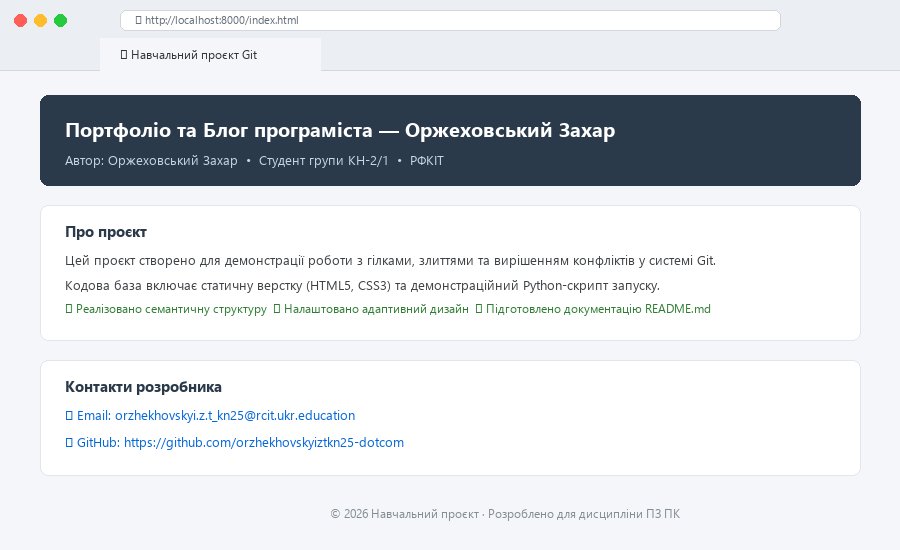
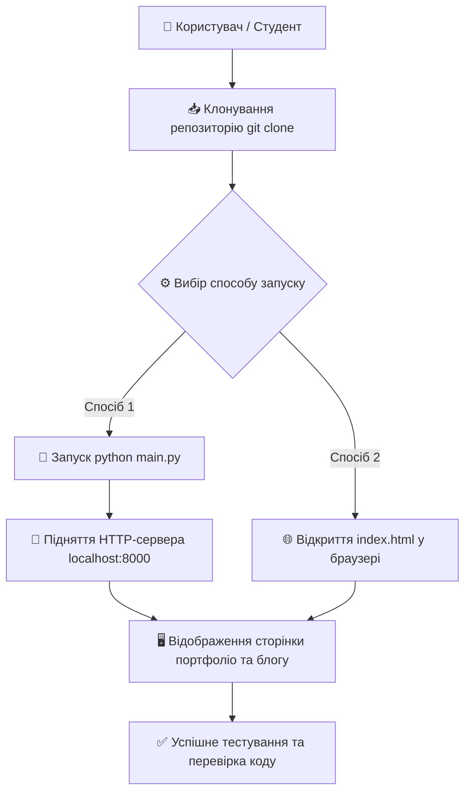

# Web Portfolio & Blog — Навчальний веб-проєкт

[](LICENSE)
[](index.html)
[](style.css)
[](main.py)
[](https://git-scm.com/)

> **Короткий опис проєкту:**  
> Цей навчальний проєкт є персональною візиткою та блогом розробника з інтегрованою демонстрацією системи контролю версій Git. Проєкт створено для практичного освоєння розгалуження, вирішення конфліктів злиття та професійного оформлення технічної документації в середовищі GitHub.

---

## 📸 Прев'ю інтерфейсу



---

## ✨ Основні можливості

- **Семантична верстка:** чиста розмітка на базі HTML5 (`<header>`, `<main>`, `<section>`, `<footer>`).
- **Сучасна стилізація:** лаконічний адаптивний інтерфейс за допомогою CSS3 без використання важких сторонніх фреймворків.
- **Локальний веб-сервер:** швидкий запуск та попередній перегляд через вбудований у Python модуль `http.server`.
- **Повна історія Git:** збережена історія комітів, демонстрація Fast-forward злиття та вирішення Merge Conflict.

---

## 📁 Структура репозиторію

```text
├── assets/
│   └── preview.png      # Знімок екрана інтерфейсу для документації
├── .gitignore           # Список виключень (конфігурації IDE, кеш Python)
├── index.html           # Головна веб-сторінка портфоліо та блогу
├── style.css            # Таблиця каскадних стилів оформлення
├── main.py              # Python-скрипт для автономного локального запуску
├── LICENSE              # Текст відкритої ліцензії MIT
└── README.md            # Головна технічна документація проєкту
```

---

## ⚙️ Встановлення

Для завантаження та розгортання проєкту на локальному комп'ютері виконайте такі кроки:

1. **Клонуйте репозиторій:**
   ```bash
   git clone https://github.com/orzhekhovskyiztkn25-dotcom/Practical-work-3.git
   ```

2. **Перейдіть у кореневий каталог проєкту:**
   ```bash
   cd Practical-work-3
   ```

3. **Перевірте наявність Python (версії 3.8 або вище):**
   ```bash
   python --version
   ```

> [!NOTE]
> Проєкт не потребує встановлення сторонніх сторонніх бібліотек чи менеджерів пакетів (`npm` чи `pip`) — усе працює «з коробки» на стандартній бібліотеці Python.

---

## 🚀 Використання

Ви можете запустити проєкт будь-яким зручним для вас способом:

### Спосіб 1. Запуск через локальний веб-сервер Python (Рекомендовано)
Запустіть скрипт `main.py`, який автоматично підніме HTTP-сервер на порту `8000` і відкриє сторінку у вашому браузері за замовчуванням:
```bash
python main.py
```
Або запустіть сервер безпосередньо через системну утиліту Python:
```bash
python -m http.server 8000
```
Після цього відкрийте у браузері посилання: **`http://localhost:8000`**.

### Спосіб 2. Пряме відкриття у браузері
Для звичайного статичного перегляду двічі клацніть по файлу `index.html` або відкрийте його через термінал:
- **Windows:**
  ```powershell
  start index.html
  ```

---

## 📊 Технологічний стек та інструменти

| Технологія / Компонент | Призначення | Версія / Стандарт |
| :--- | :--- | :---: |
| **HTML5** | Семантична структура, розмітка розділів і контенту | Living Standard |
| **CSS3** | Оформлення карток, тіні, кольорова палітра, шрифти | Modern CSS |
| **Python** | Автоматизація та вбудований локальний сервер | 3.10+ |
| **Git** | Контроль версій, керування гілками та фіксація станів | 2.40+ |
| **GitHub** | Хостинг репозиторію, трекінг завдань та публікація | Web Platform |

---

## 🔄 Схема роботи проєкту

Діаграма послідовності взаємодії користувача із середовищем проєкту:



---

## 📜 Ліцензія

Цей проєкт поширюється на умовах відкритої ліцензії **MIT**.  
Повний юридичний текст ліцензії знаходиться у файлі [LICENSE](LICENSE).

---

## 👨‍💻 Автори та контакти

- **Розробник:** Оржеховський Захар
- **Група:** КН-2/1
- **Заклад:** ВСП «Рівненський фаховий коледж інформаційних технологій» (РФКІТ)
- **Email:** [orzhekhovskyi.z.t_kn25@rcit.ukr.education](mailto:orzhekhovskyi.z.t_kn25@rcit.ukr.education)
- **GitHub:** [@orzhekhovskyiztkn25-dotcom](https://github.com/orzhekhovskyiztkn25-dotcom)
